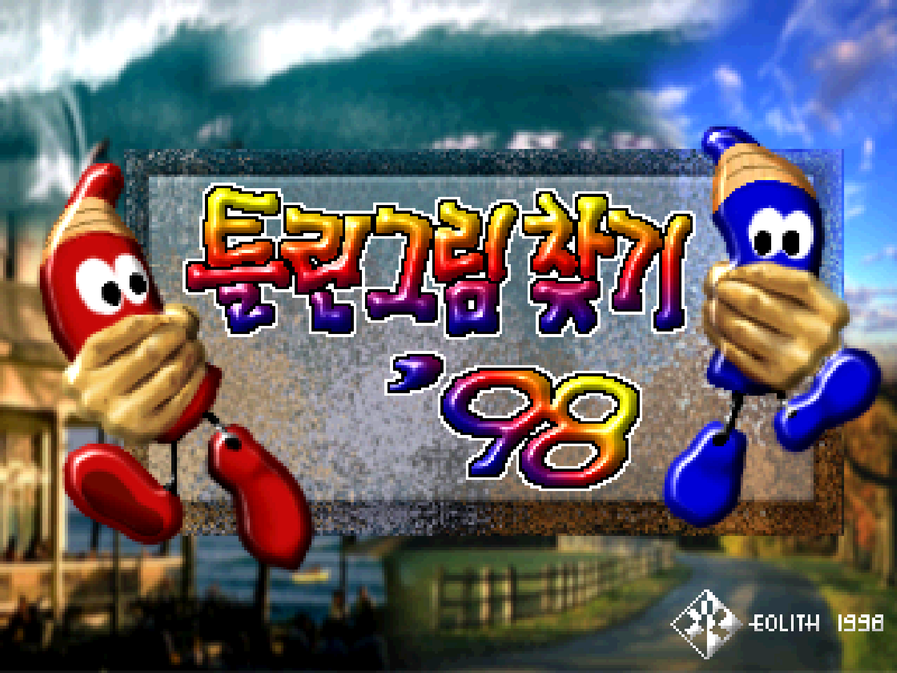
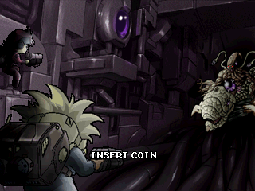

# Eolith core for MiSTer

A MiSTer FPGA core for Eolith's Hyperstone arcade boards (MAME's `vegaeo.cpp`, `eolith.cpp` and
`eolith16.cpp`), built with Quartus Prime 17.0.2 Lite for the DE10-nano.

**Status: 23 sets on three boards. Crazy War, Hidden Catch and Hidden Catch 3 play on the board; a
quick test of a number of the other sets ran them all.**

## Contents

- [History](#history)
- [Games](#games)
  - [Supported](#supported)
  - [Not yet](#not-yet)
  - [Out of scope for now](#out-of-scope-for-now)
- [Hardware](#hardware)
  - [Video timing](#video-timing)
- [Screenshots](#screenshots)
- [Installation](#installation)
- [Controls](#controls)
- [Status](#status)
  - [Features](#features)
  - [Todo](#todo)
  - [Resource usage](#resource-usage)
- [AI Attestation](#ai-attestation)
- [Verification](#verification)
- [Acknowledgements](#acknowledgements)
- [Layout](#layout)
- [License](#license)

## History

* **20261011** (`releases/Arcade-Eolith_20261011.rbf`, commit `82f4991`, fitter seed 1)
  * QS1000 sound closer to the chip than MAME, from a Hidden Catch PCB recording, a Mission Craft PCB
    recording and General MIDI files recorded on a QS1000 (`docs/QS1000_FEATURES.md`): held notes loop and
    fade at key-off, ADPCM decoded as IMA, [207] the left volume, pitch bend
  * Raccoon World (MACHINE_NOT_WORKING in MAME): 23 sets
  * Light pens: d-pad stepping, stick modes, mouse; Hidden Catch 3's EEPROM defaults (English, pen offsets
    zero) in its `.mra`
  * CRT Adjust (H-Size, H-Position, V-Shift), Crop and Crop offset; the HDMI scaler's options hidden under
    direct video

* **20261010** (`releases/Arcade-Eolith_20261010.rbf`, commit `3f882db`, fitter seed 2)
  * **Alpha release** : 22 sets on the Vega, Gradation 2D and `eolith16` boards
  * Crazy War, Hidden Catch and Hidden Catch 3 played on the board; a quick test of a number of the
    other sets on this build ran them all
  * Fast ROM loading, EEPROM / NVRAM saving, DIP switches, flip screen, Pause, stereo mix
  * Hidden Catch 3's light pens from the analog sticks, with a cross drawn for each pen

## Games

Three boards, each a Hyperstone CPU drawing into a double-buffered frame buffer, with no sprites or
tiles: the Vega (Crazy War: GMS30C2132, 8-bit pixels through a palette, a QS1000 sound board on a
latch), the Gradation 2D (the `eolith.cpp` sets: E1-32N, 15-bit RGB pixels, an i8032 sound CPU driving
a QS1000 over a serial line, a 93C66 EEPROM) and the `eolith16` board (KlonDike+: E1-16T, 8-bit pixels
through a fixed palette, an OKI M6295). The board is chosen by the `.mra`. A 64 MB SDRAM module is
required.

### Supported

Sets with an `.mra` in `releases/`. Crazy War, Hidden Catch and Hidden Catch 3 have been played on the
board; a quick test of a number of the others on the release build ran them all (which ones was not
recorded).

| Name | Year | Manufacturer | Set | Board | Notes |
|-|-|-|-|-|-|
| Crazy War | 2002 | Eolith | `crazywar` | Vega | |
| Hidden Catch (World) / Tul Lin Gu Lim Chat Ki '98 (Korea) (pcb ver 3.03) | 1998 | Eolith | `hidnctch` | Gradation 2D | |
| Hidden Catch (World) / Tul Lin Gu Lim Chat Ki '98 (Korea) (pcb ver 3.02) | 1998 | Eolith | `hidnctcha` | Gradation 2D | Clone of `hidnctch` |
| Iron Fortress | 1998 | Eolith | `ironfort` | Gradation 2D | |
| Gongtit Jiucoi Iron Fortress (Hong Kong) | 1998 | Eolith (Excellent Competence Ltd. license) | `ironfortc` | Gradation 2D | Clone of `ironfort` |
| Linky Pipe | 1998 | Eolith | `linkypip` | Gradation 2D | |
| Puzzle King (Dance & Puzzle) | 1998 | Eolith | `puzzlekg` | Gradation 2D | |
| Candy Candy | 1999 | Eolith | `candy` | Gradation 2D | IMPERFECT_GRAPHICS in MAME |
| Hidden Catch 2 (pcb ver 3.03) (Kor/Eng) (AT89c52 protected) | 1999 | Eolith | `hidctch2` | Gradation 2D | MAME's protection patch |
| Hidden Catch 2 (pcb ver 1.00) (Kor/Eng/Jpn/Chi) | 1999 | Eolith | `hidctch2a` | Gradation 2D | Clone of `hidctch2` |
| Hidden Catch 2000 (AT89c52 protected) | 1999 | Eolith | `hidnc2k` | Gradation 2D | MAME's protection patch |
| Land Breaker (World) / Miss Tang Ja Ru Gi (Korea) (pcb ver 3.02) | 1999 | Eolith | `landbrk` | Gradation 2D | |
| Land Breaker (World) / Miss Tang Ja Ru Gi (Korea) (pcb ver 3.03) (AT89c52 protected) | 1999 | Eolith | `landbrka` | Gradation 2D | Clone of `landbrk`; MAME's protection patch |
| Land Breaker (World) / Miss Tang Ja Ru Gi (Korea) (pcb ver 1.0) (AT89c52 protected) | 1999 | Eolith | `landbrkb` | Gradation 2D | Clone of `landbrk`; MAME's protection patch |
| New Hidden Catch (World) / New Tul Lin Gu Lim Chat Ki '98 (Korea) (pcb ver 3.02) | 1999 | Eolith | `nhidctch` | Gradation 2D | |
| Penfan Girls - Step1. Mild Mind (set 1) | 1999 | Eolith | `penfan` | Gradation 2D | |
| Penfan Girls - Step1. Mild Mind (set 2) | 1999 | Eolith | `penfana` | Gradation 2D | Clone of `penfan` |
| Hidden Catch 3 (ver 1.00 / pcb ver 3.05) | 2000 | Eolith | `hidctch3` | Gradation 2D | Light pens (Controls) |
| Raccoon World | 1998 | Eolith | `raccoon` | Gradation 2D | MACHINE_NOT_WORKING in MAME ("game animation & timers seem too fast?") |
| Steal See | 2000 | Moov Generation / Eolith | `stealsee` | Gradation 2D | |
| Fortress 2 Blue Arcade (World) (ver 1.01 / pcb ver 3.05) | 2001 | Eolith | `fort2b` | Gradation 2D | |
| Fortress 2 Blue Arcade (Korea) (ver 1.00 / pcb ver 3.05) | 2001 | Eolith | `fort2ba` | Gradation 2D | Clone of `fort2b` |
| KlonDike+ | 1999 | Eolith | `klondkp` | `eolith16` | 320 x 200 picture |

### Not yet

None: every set of the three drivers has an `.mra`.

### Out of scope for now

| MAME description | Why |
|-|-|
| BnB Arcade, Happy Tour, Touryuumon (`ghosteo.cpp`) | A 200 MHz ARM920T system-on-chip with an MMU; shares only the QS1000 with these boards |

## Hardware

| Chip | Function | Status |
|-|-|-|
| Hyperstone GMS30C2132 (Vega), E1-32N (Gradation 2D), E1-16T (`eolith16`) | Main CPU | Arcade-Vamphalf_MiSTer's pipelined `e1_pipe.sv`, written there from MAME's `e132xs`, with this core's timing changes (`rtl/e1/PROVENANCE.md`); behind Vamphalf's I- and D-caches with this core's address decode (`rtl/eo_cpumem.sv`, generated by `scripts/gen_eo_cpumem.py`) |
| Frame buffers | Video | Written here (`rtl/eo_video.sv`): one VRAM for the three boards' pixel formats, the scan-out reading the buffer the CPU is not drawing |
| QS1000 (8052 + 32-voice wavetable) | Sound, Vega and Gradation 2D | From Arcade-Vamphalf_MiSTer: jotego's JT8051 with changes (`rtl/qs1000/PROVENANCE.md`), the voice engine written from MAME's `qs1000.cpp`. On the Vega it reads the main CPU's latch; on the Gradation 2D its serial input |
| i8032 | Gradation 2D sound CPU | A second JT8051, with timer 2 added (`docs/HACKS.md`) |
| OKI M6295 | `eolith16` sound | jotego's JT6295 with Arcade-Vamphalf_MiSTer's ROM bridge and sample cache (`rtl/sound/PROVENANCE.md`) |
| 93C66 | Settings EEPROM, Gradation 2D and `eolith16` | Written here (`rtl/eo_eeprom93cxx.sv`) from Arcade-Vamphalf_MiSTer's 93C46 model |
| AT28C16 | Settings NVRAM, Vega | Written here (`rtl/eo_main.sv`) |

### Video timing

57.2727 MHz / 8 = 7.15909 MHz dot clock, 455 dots by 262 lines: 15.734 kHz lines, 60.05 Hz frames.
Visible 320 x 240 (`eolith16`: 320 x 200). MAME gives no video timing (`set_refresh_hz(60)`,
`set_size(512, 262)` are placeholders, `eolith.cpp:714-717`); the dot clock is half the boards'
14.31818 MHz crystal by inference, and the totals are chosen (`docs/HACKS.md`). A board's notes in
the driver give 15.64 kHz and 60 Hz measured.

## Screenshots

### Hidden Catch

### Crazy War

## Installation

A 64 MB SDRAM module is required: Crazy War and 16 of the 22 `eolith.cpp` sets are larger than 32 MB.

* Take the latest `*.rbf` from `releases/` and put it in `_Arcade/cores`, renamed to drop the
  `Arcade-` prefix (`Arcade-Eolith_YYYYMMDD.rbf` becomes `Eolith_YYYYMMDD.rbf`). MiSTer launches
  the highest-sorting match for `<rbf>Eolith</rbf>`, and a `Eolith_*.rbf` sorts above every
  `Arcade-Eolith_*.rbf`
* Take the `*.mra` files and the `_alternatives` folder from `releases/` and put them in `_Arcade`
  (or a subdirectory starting with an underscore, e.g. `_Arcade/_Eolith`)
* Put the MAME merged or split ROM sets in `games/mame`

To run a development build instead: `python scripts/build_staged.py`, then `python scripts/deploy.py`
with a `mister.env` (see `scripts/deploy.py`).

## Controls

Joystick: Button 1 to Button 4, Start, Coin, Pause, Service Coin, Service Mode. The `.mra` names the
buttons per game: Crazy War's button 1 is Shot, the Hidden Catch games' Mark, KlonDike+'s Pick.

Hidden Catch 3's light pens, set on the OSD's pen lines (shown only for this set):

* **D-pad:** moves the player's pen a step a frame, one unit (two dots) for the first 12 frames it is held,
  then three.
* **Left analog stick**, per player: *Aim* (the default) puts the pen where the stick points whenever the
  stick moves, and leaves it where the d-pad or the mouse put it while the stick is still; *D-pad* makes the
  stick step like the d-pad; *Auto* does both: a full deflection steps, a partial one aims (an arcade stick on
  a gamepad encoder gives only full ones).
* **Mouse:** off by default; *Mouse aims* gives it to P1 or P2, whose pen it moves; its left button is that
  player's Pen button.
* **Crosshair:** a cross at each pen, magenta for player 1 and cyan for player 2 in a black outline;
  *Crosshair* shows both, one or none.

Button 1 (Pen) presses the pen.

The game keeps a calibration offset for each pen in its EEPROM (the `.nvm`); a blank one is exact. The
service menu's TEST MODE, PEN TEST shows where the game puts each pen and stores a new offset from a
click: click only with the cross on the centre mark, or later clicks land off target. A press that flashes
the screen and marks nothing is aiming outside the pictures after a bad calibration; deleting the `.nvm`
restores it. Without an `.nvm` the `.mra`'s default EEPROM applies: the game's defaults with English text and
both offsets zero.

Keyboard, MAME's defaults: arrows / R F D G, buttons LCtrl LAlt Space LShift Z X / A S Q W E,
Start 1 / 2, Coin 5 / 6; F2 service switch, 9 / 0 service coins, P pause.

## Status

Known issues:

* **Ten sets still show generic button names** ("Button 1", "Button 2"): Candy Candy, Crazy War's
  button 2, Fortress 2 Blue Arcade, Iron Fortress, Land Breaker, Linky Pipe, Penfan Girls, Puzzle King,
  Raccoon World, Steal See.
* The video timing is inferred, not measured (Video timing).
* The core's speed against the original boards has not been measured on hardware.
* Sound has not been compared with MAME by ear on the board. Where the QS1000 differs from MAME it follows
  recordings (`docs/QS1000_FEATURES.md`): it loops held notes and fades them at key-off (MAME stops them at
  the sample's end), with one fade rate for every instrument; decodes ADPCM as IMA; has [207] as the left
  volume; and bends pitch from [204], linearly in the rate (about 12 cents a step up, 7 down), from a Hidden
  Catch PCB recording and General MIDI recordings on a QS1000.
* The M6295's output (KlonDike+) has not been compared with MAME; nor have Hidden Catch 3's pens, which
  work on the board.

`docs/MAME_KLUDGES.md` lists what is taken from MAME as behaviour and what is known not to be
right. `docs/HACKS.md` lists this core's own approximations. `docs/ROADMAP.md` is the plan and its
progress; `docs/LESSONS_LEARNED.md` is what it cost.

### Features

* DIP switches from the `.mra` (`DIP;` in the OSD): done
* Inputs: done; MAME's default keyboard mapping
* CRT Adjust (H-Position, V-Shift, H-Size, V-Size): H-Position, V-Shift and H-Size (`rtl/video/eo_crt.sv`, rmonic79's
  `crt_adjust.sv`); no V-Size. H-Size widens to the right: a larger picture needs H-Position moved left to fit the
  line
* HDMI scaling (integer scale, crop, crop offset): done (crop 216 or 224 of the 240 lines)
* HDMI rotation (orientation): done (Off, CW, CCW), for a monitor on its side; every set is horizontal
* Flip screen, HDMI and analog, from the OSD or the DIP (fake DIP where the game has none): done, from
  the OSD (no board here has a flip); checked in simulation on the three boards against MAME's frame
  turned 180 degrees (the unflipped scan-out is pixel-identical to MAME's)
* HDMI-only options hidden under direct video: done
* Peripheral menus shown only for games that use them: n/a
* Rotary joysticks (Ikari Warriors controls, GRS keystroke mode), where used: n/a
* Light guns: mouse, analog stick and synthetic crosshair, where used: done for Hidden Catch 3's pens:
  d-pad, analog stick (Auto, Aim, D-pad), mouse, a cross per player
* Audio mix (Mono, None, 25%, 50%): done (None, 25%, 50%, 100%)
* Hiscore saving (`hiscore.v`, with autosave): not in this core. MAME's `hiscore.dat` covers only Iron Fortress,
  Candy Candy and Land Breaker, whose scores sit in work RAM behind the CPU's caches
* NVRAM / EEPROM saved to the `.nvm` file: done
* Fast ROM loading via DDR: done
* Pause (with CPU suspended): done
* Sound: QS1000 (Vega, Gradation 2D) and M6295 (`eolith16`)
* Savestates (optional): not yet
* Cheats (optional): not yet

### Todo

- [ ] The game's own button names for the ten sets above
- [ ] Sound judged against MAME on the board
- [ ] Frame times on the board against MAME's (the `Eolith_stp` revision's probes)
- [ ] The video timing from a board measurement

### Resource usage

The release revision (`Eolith`, commit `82f4991`, seed 1) on the DE10-nano's Cyclone V 5CSEBA6, speed
grade 7, every clock meeting timing (clk_sys +0.870 ns, hdmi pll +0.272 ns; the lowest hold slack
+0.248 ns):

| resource | used | available |
| --- | --- | --- |
| Logic (ALMs) | 31,933 | 41,910 |
| Block memory bits | 3,730,527 | 5,662,720 |
| RAM blocks | 446 | 553 |
| DSP blocks | 50 | 112 |
| PLLs | 3 | 6 |

RAM blocks (81%) are the resource to watch; the frame buffers take 240 of them.

## AI Attestation

This core is being developed with heavy use of a frontier coding assistant.

## Verification

Not PCB-validated. MAME's `vegaeo.cpp`, `eolith.cpp`, `eolith16.cpp`, `qs1000.cpp` and `e132xs` are the
reference. Where the core follows MAME on something MAME marks as uncertain, it is listed in
`docs/MAME_KLUDGES.md`; the core's own approximations are in `docs/HACKS.md`.

* CPU: `e1_pipe` agrees with MAME's interpreter after every instruction (PC, SR, all registers, every
  bus access), at 0 and 3 bus wait states, on Crazy War's first 2,000,000 instructions, and on
  Arcade-Vamphalf_MiSTer's random conformance suite (`scripts/e1_regress.py --replay --pipe`, 104 of
  104 runs, 255 of 255 primary opcodes).
* Whole board (`sim/sys_tb`, the SDRAM controller and a chip model) against MAME's trace from reset:
  all 2,000,000 retired PCs on `crazywar` (178,383 of 178,383 data accesses); on `hidnctch` every data
  access, and on `klondkp` 1,664,401 retired PCs, up to the first vblank poll, where the timing
  differs.
* Video: the scan-out is pixel-identical to MAME on 40 of 40 captured `crazywar` frames, 6 of 6
  `hidnctch` and 6 of 6 `klondkp` frames (attract and play).
* `.mra`: every set's image is identical to MAME's ROM_START image (`scripts/build_mra.py`); the
  protection patches checked against MAME's CPU view (`hidctch2`, `landbrka`).
* EEPROM: MAME's pin traffic for `hidnctch` over 1,200 frames, from blank: 12,112 of 12,112 data reads
  agree (`sim/ee_tb`).
* Gradation 2D sound (`sim/snd_tb`, `hidnctch`, 1,200 frames with a coin and a start): 4,711 of 4,711
  QS1000 register writes and 1,805 of 1,805 sound CPU data reads as MAME's.
* No interrupts: over 3,000 frames, no timer, INT1-4 or IO entries on any set of the three drivers in
  MAME (`scripts/mame_irqcount.py`); the games poll vblank.

## Acknowledgements

- **Sorgelig** and the **MiSTer-devel team** for the
  [Template_MiSTer](https://github.com/MiSTer-devel/Template_MiSTer) framework, and Sorgelig's
  `sdram.v`, here by way of the Psikyo, Fuuki and KonamiGX cores.
- The **MAMEdev team**: Tomasz Slanina and Pierpaolo Prazzoli (`eolith.cpp`), Pierpaolo Prazzoli
  (`vegaeo.cpp`, `eolith16.cpp`, `e132xs`), Philip Bennett (`qs1000.cpp`), Mirko Buffoni and Aaron
  Giles (`okim6295.cpp`), for the driver and device emulations that are this core's specification.
- **Jose Tejada (jotego)** for JT8051 and JT6295 ([jtcores](https://github.com/jotego/jtcores)).

## Layout

Standard [Template_MiSTer](https://github.com/MiSTer-devel/Template_MiSTer) structure:

| path | contents |
| - | - |
| `sys` | MiSTer framework, vendored from the template, never edited |
| `rtl` | core source; vendored modules carry a `PROVENANCE.md` |
| `releases` | `.rbf` and `.mra` files; clones in `_alternatives` |
| `docs` | roadmap, workflow, release process, kludges, hacks, lessons |
| `sim` | ModelSim and Verilator testbenches |
| `scripts` | build, deploy, capture and verification tooling |
| `debug` | reference captures from MAME used as ground truth (gitignored) |
| `roms` | your own MAME sets (gitignored, never committed) |

## License

GPL-3.0 (see `LICENSE`). Imported components keep their own licences; each vendored directory's
`PROVENANCE.md` has the detail, `scripts/vendor.json` pins every vendored file, and every modified
vendored file states the change in its header.

Game ROMs contain copyrighted material and are not included. Obtaining them is your
responsibility.
